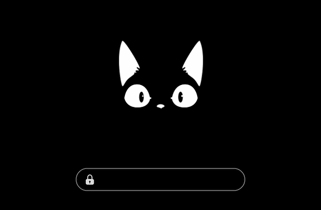

# PlymouthTheme-Cat (Black Edition)

A minimal Plymouth boot splash: an animated cat on a pure black background, with a clean password field for **LUKS-encrypted** systems.

<p align="center">
  
</p>

This is a modified version of [PlymouthTheme-Cat](https://github.com/krishnan793/PlymouthTheme-Cat) by **krishnan793**.

## What's different from the original

| | Original | Black Edition |
|---|---|---|
| Background | Dark grey (`#161616`) | Pure black |
| Animation frames | 800×600 with grey baked in | Cropped, transparent background, smooth edges |
| LUKS password prompt | Not supported (no prompt visible) | Minimal pill-shaped field with lock icon and dots |
| Animation speed | Fixed | Adjustable (`speed`) |
| Theme size | ~1.6 MB | ~0.9 MB |

## Requirements

- Plymouth with the `script` plugin (included in the standard `plymouth` package on most distributions)
- Kernel parameters `quiet splash`
- Tested on Kali Linux (Debian-based) with LUKS full-disk encryption

## Installation

### Debian, Kali, Ubuntu and derivatives

```bash
sudo apt install plymouth git
sudo git clone https://github.com/sophia-sec/PlymouthTheme-Cat.git /usr/share/plymouth/themes/PlymouthTheme-Cat
sudo plymouth-set-default-theme -R PlymouthTheme-Cat
```

### Fedora

```bash
sudo dnf install plymouth plymouth-plugin-script git
sudo git clone https://github.com/sophia-sec/PlymouthTheme-Cat.git /usr/share/plymouth/themes/PlymouthTheme-Cat
sudo plymouth-set-default-theme -R PlymouthTheme-Cat
```

### Arch Linux

```bash
sudo pacman -S plymouth git
sudo git clone https://github.com/sophia-sec/PlymouthTheme-Cat.git /usr/share/plymouth/themes/PlymouthTheme-Cat
sudo plymouth-set-default-theme -R PlymouthTheme-Cat
```

On Arch, `plymouth` must also be added to the `HOOKS` array in `/etc/mkinitcpio.conf` (before `encrypt` / `sd-encrypt` if you use LUKS), followed by `sudo mkinitcpio -P`.

The `-R` flag rebuilds the initramfs, which is required for the theme to show up at boot.

### Enable the splash screen in GRUB

Make sure `/etc/default/grub` contains `quiet splash`:

```
GRUB_CMDLINE_LINUX_DEFAULT="quiet splash"
```

Then regenerate the GRUB config:

```bash
# Debian / Kali / Ubuntu
sudo update-grub

# Fedora
sudo grub2-mkconfig -o /boot/grub2/grub.cfg

# Arch
sudo grub-mkconfig -o /boot/grub/grub.cfg
```

Reboot, and the cat should greet you.

## Customization

All settings live in `PlymouthTheme-Cat.script`:

```bash
sudo nano /usr/share/plymouth/themes/PlymouthTheme-Cat/PlymouthTheme-Cat.script
```

| Setting | Default | Effect |
|---|---|---|
| `speed` | `2` | Animation speed. `1` = fastest, higher values = slower |
| `field_gap` | `60` | Distance in pixels between the cat and the password field |

After any change, rebuild the initramfs:

```bash
sudo plymouth-set-default-theme -R PlymouthTheme-Cat
```

## Testing without rebooting

Switch to a text console with `Ctrl+Alt+F3`, log in and run:

```bash
sudo plymouthd
sudo plymouth show-splash
sleep 3
sudo plymouth ask-for-password --prompt="Test"
sudo plymouth quit
```

Type anything and press Enter to close the password prompt. Return to your desktop with `Ctrl+Alt+F1` or `Ctrl+Alt+F7`.

## Troubleshooting

**Only text is shown during boot.**
Check that `quiet splash` is set in GRUB and that you ran `update-grub` afterwards.

**The splash appears late, stretched or in low resolution.**
Your graphics driver is probably loaded too late. Add it to the initramfs (e.g. `i915` for Intel, `amdgpu` for AMD) in `/etc/initramfs-tools/modules`, then run `sudo update-initramfs -u`. With the proprietary NVIDIA driver, also add `nvidia-drm.modeset=1` to the kernel parameters.

**The password prompt does not show up.**
Your password input still works. Type it blind and press Enter. Pressing `Esc` during boot switches to text mode.

## Uninstall

```bash
sudo plymouth-set-default-theme -R text
sudo rm -r /usr/share/plymouth/themes/PlymouthTheme-Cat
```

## Credits and License

- Original theme and cat animation: [krishnan793/PlymouthTheme-Cat](https://github.com/krishnan793/PlymouthTheme-Cat)
- Black Edition modifications (2026-10-29): black background, transparent cropped frames, LUKS password field, adjustable speed

Licensed under the **GNU General Public License v3.0**, same as the original. See [LICENSE](LICENSE).
